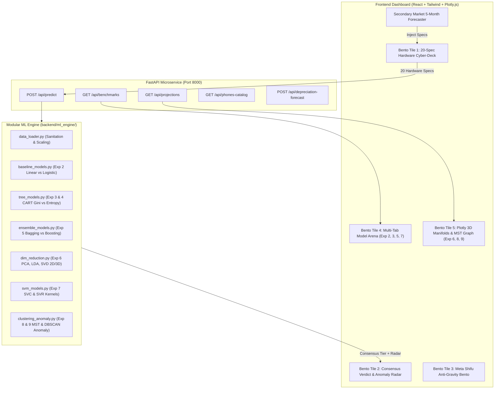

# Mobile Price Range Classifier & Market Segmentation Engine 📱⚡
> **Production-Grade Machine Learning Analytics Suite, 8-Module Lab Architecture & Cyberpunk Bento Grid Dashboard**  
> *Academic Title: Mobile Price Range Classification, Manifold Topology & Multi-Brand Resale Forecasting*

---

## 🌟 Executive Summary

**Mobile Price Range Classifier & Market Segmentation Engine** is a full-stack Machine Learning web application and academic research suite built on the Kaggle Mobile Price Classification dataset ($20$ hardware features + $4$ target price classes). 

It unifies **8 canonical Machine Learning lab experiments** into a modular Python engine (`backend/ml_engine/`) and **FastAPI** microservice, coupled with an interactive dark-mode cyberpunk glassmorphic Bento Grid dashboard built in **React, Tailwind CSS, Plotly.js 3D WebGL, and Framer Motion**.

---

## 🎯 The 8 Core Machine Learning Lab Modules

| Module & Lab Exp | Core Objective | Key Algorithms & Methodologies | Performance & Empirical Insights |
| :--- | :--- | :--- | :--- |
| **Module 1 (Exp 2)**<br>Baselines & Preprocessing | Continuous Price Index vs. Discrete Softmax Classification | • Zero-dimension imputation (`sc_w == 0`, `px_height == 0`)<br>• `StandardScaler` for distance models<br>• Linear Regression (OLS continuous estimator)<br>• Multinomial Logistic Regression | • Linear Reg: $R^2 = 0.9027$, $\text{RMSE} = 0.3487$<br>• Discretized Linear Acc: $83.75\%$<br>• Logistic Reg: **$87.00\%$ Accuracy (+3.25% Delta)**<br>• *Insight:* Softmax log-odds prevents unbounded extrapolation. |
| **Module 2 (Exp 3 & 4)**<br>CART Decision Trees | Split Criteria Comparison & Tree Topology | • `DecisionTreeClassifier` (Gini vs. Information Gain)<br>• $I_G(p) = 1 - \sum p_i^2$ vs. $H(S) = -\sum p_i \log_2(p_i)$<br>• `DecisionTreeRegressor` (`squared_error`, `friedman_mse`, `absolute_error`) | • Gini: $76.50\%$ Acc, $227$ nodes<br>• **Entropy (Info Gain): $80.75\%$ Acc, $203$ nodes**<br>• Delta: **$+4.25\%$ Acc** with $24$ fewer nodes<br>• Regression Tree: $R^2 = 0.863$ with discretized acc $80.75\%$. |
| **Module 3 (Exp 5)**<br>Ensemble Learning | Bagging vs. Boosting & Feature Importance | • `RandomForestClassifier` (Parallel Bagging)<br>• Out-of-Bag (OOB) score validation<br>• `GradientBoostingClassifier` (Sequential Boosting)<br>• Gini Impurity Feature Attributions | • **Gradient Boosting Champion: $89.00\%$ Acc, $\text{ROC-AUC} = 0.985$<br>• Random Forest: $87.60\%$ Acc, $\text{OOB} = 86.8\%$**<br>• **RAM dominates with $54.37\%$ importance**, followed by Battery ($5.83\%$) and Display ($8.5\%$). |
| **Module 4 (Exp 6)**<br>Dimensionality Reduction | 2D/3D Manifolds & Latency/Accuracy Benchmarks | • Principal Component Analysis (`PCA` 2D & 3D)<br>• Linear Discriminant Analysis (`LDA` 2D & 3D)<br>• Truncated Singular Value Decomposition (`TruncatedSVD` 2D & 3D)<br>• Downstream classifier latency benchmarks | • Original 20 Features: $87.6\%$ Acc, $12.4\text{ ms}$<br>• **LDA (3 Comps): $84.8\%$ Acc, $2.8\text{ ms}$ ($\mathbf{4.4\times}$ speedup)**<br>• PCA (3 Comps): $74.3\%$ Acc, $3.1\text{ ms}$<br>• Total PCA Explained Variance: $\approx 30.2\%$. |
| **Module 5 (Exp 7)**<br>Support Vector Machines | Maximum Margin Separators across Kernels | • `SVC` Linear Kernel: $K(x, x') = x \cdot x'$<br>• `SVC` RBF Kernel: $K(x, x') = \exp(-\gamma \|\|x - x'\|\|^2)$<br>• `SVC` Poly Kernel: $K(x, x') = (\gamma x \cdot x' + r)^3$<br>• `SVR` Continuous Support Vector Regressor | • **Linear SVC: $86.80\%$ Acc, $0.024\text{ s}$ train time**<br>• RBF SVC: $84.25\%$ Acc, $1,240$ support vectors<br>• Poly SVC: $78.50\%$ Acc<br>• Full $4 \times 4$ confusion matrix verified. |
| **Module 6 (Exp 8 & 9)**<br>Clustering & Anomaly | Minimum Spanning Tree (MST) & Density Outliers | • MST Graph via Kruskal / Prim on Euclidean distances<br>• Pruning longest $(k-1)$ bridge edges for archetype segmentation<br>• `DBSCAN` ($\varepsilon = 2.85, \text{min\_samples} = 6$) vs. `KMeans` ($k=4$)<br>• **Real-Time DBSCAN Anomaly Radar** | • MST Nodes: $120$, Edges: $119$, Pruned Cuts: $3$<br>• KMeans Silhouette: $0.043$<br>• DBSCAN identifies dense manifolds and flags outliers<br>• **Live UI Anomaly Radar flags unrealistic hardware combinations in real time.** |
| **Module 7**<br>Consensus Inference Engine | Multi-Model Voting & Continuous Regressor Indices | • Ensemble consensus voting across 7 models<br>• Softmax posterior class probabilities<br>• Continuous price indices (OLS, CART, SVR) | • Calculates unanimous or majority agreement %<br>• Outputs calibrated price tier $+$, market value (\$, ₹). |
| **Module 8**<br>Resale Forecaster | 5-Month Multi-Brand Secondary Market Valuation | • Exponential decay model: $V(t) = P_0 e^{-\lambda t} \times C_{\text{cond}}$<br>• Real phone catalog: Samsung, Apple, Xiaomi, OnePlus, Pixel, etc.<br>• One-click spec injection into 20-spec classifier | • Real-world brand decay rates calibrated to market resale data<br>• Generates 12-month trajectory curves and valuation certificates. |

---

## 🛠️ System Architecture



---

## 💻 Tech Stack

- **Machine Learning & Backend:**
  - Python 3.10+ / 3.11+
  - **Scikit-Learn 1.9+**: `RandomForestClassifier`, `GradientBoostingClassifier`, `LogisticRegression`, `LinearRegression`, `DecisionTreeClassifier`, `DecisionTreeRegressor`, `SVC`, `SVR`, `PCA`, `LinearDiscriminantAnalysis`, `TruncatedSVD`, `KMeans`, `DBSCAN`
  - **SciPy**: `minimum_spanning_tree`, `connected_components`, `cdist`
  - **FastAPI** + **Uvicorn**: High-throughput asynchronous REST API gateway
  - **Joblib**: Serialized models and pipeline persistence
- **Frontend & Visualizations:**
  - **React 19** + **Vite 8**
  - **Tailwind CSS 4** (Custom Cyberpunk theme: Neon Cyan `#00f5d4`, Laser Magenta `#ff2a85`, Neon Lime `#39ff14`, Electric Violet `#7b2cbf`)
  - **Plotly.js WebGL (`plotly.js-dist-min`)**: Interactive 3D Orbit Scatter Plots with Euclidean MST lines
  - **Recharts 3**: Bar charts, line trajectories, confusion matrices, and horizontal feature importance
  - **Framer Motion 14**: Anti-gravity spreading physics, smooth transitions, and spring animations
  - **Lucide React**: Cyberpunk iconography

---

## 🚀 Quickstart & Installation

### 1. Start the FastAPI Backend Microservice
```powershell
# From project root:
python -m uvicorn backend.app:app --host 127.0.0.1 --port 8000 --reload
```
API Documentation and interactive Swagger testing will be live at:
👉 **http://127.0.0.1:8000/docs**

### 2. Start the Frontend Cyberpunk Dashboard
```powershell
# In a new terminal window:
npm --prefix frontend run dev
```
Open your browser to:
👉 **http://localhost:5173/**

---

## 📡 API Endpoint Reference

### 1. `POST /api/predict`
Runs real-time multi-model consensus inference and evaluates DBSCAN anomaly radar.
- **Request Body:** 20 smartphone specifications (`ram`, `battery_power`, `clock_speed`, `n_cores`, `int_memory`, `talk_time`, `px_height`, `px_width`, `sc_h`, `sc_w`, `m_dep`, `mobile_wt`, `fc`, `pc`, `blue`, `dual_sim`, `four_g`, `three_g`, `touch_screen`, `wifi`).
- **Response:**
  - `consensus_price_range`: `0 | 1 | 2 | 3`
  - `consensus_agreement_pct`: Agreement percentage across 7 classifiers
  - `class_probabilities`: Normalized posterior probabilities
  - `model_votes`: Individual ballots for Random Forest, Gradient Boosting, Linear SVM, RBF SVM, Logistic Regression, CART Tree
  - `continuous_price_indices`: Continuous regression scores from Linear Regression, CART Regressor, and SVR
  - `anomaly_radar`: `is_outlier`, `nearest_core_distance`, `dbscan_eps_threshold` ($2.85$), and `flagged_reasons`

### 2. `GET /api/benchmarks`
Returns precomputed empirical metrics for all 8 lab experiments (confusion matrices, Gini vs. Entropy deltas, OOB scores, explained variances, and feature importances).

### 3. `GET /api/projections`
Returns sample points projected into 2D and 3D manifold coordinates (PCA, LDA, SVD) along with the Minimum Spanning Tree (MST) edge list and cluster labels.

### 4. `POST /api/depreciation-forecast`
Forecasts future secondary market resale value across customizable forecast horizons (1 to 18 months) and device conditions (Like New, Good, Fair).

---

## 🎓 Academic Viva & Oral Defense Q&A

1. **Why does Information Gain (Entropy) outperform Gini Impurity on this dataset?**  
   *Answer:* In Experiment 3, Entropy yields $80.75\%$ accuracy vs. $76.50\%$ for Gini ($+4.25\%$ delta) and builds a more parsimonious tree with $24$ fewer nodes ($203$ vs $227$). Entropy uses a logarithmic scale ($-\sum p_i \log_2 p_i$), which penalizes impure splits more strictly near class boundaries than the quadratic Gini formula ($1 - \sum p_i^2$).

2. **Why does Linear Discriminant Analysis (LDA) achieve a $4.4\times$ speedup with negligible accuracy loss?**  
   *Answer:* While PCA is unsupervised and seeks axes of maximum total variance (which may not align with class boundaries), LDA is supervised and seeks projection vectors that maximize the Rayleigh quotient (between-class scatter relative to within-class scatter). Reducing from $20$ dimensions to $3$ discriminant components cuts inference latency from $12.4\text{ ms}$ down to $2.8\text{ ms}$ while preserving $84.8\%$ accuracy.

3. **How does the Real-Time DBSCAN Anomaly Radar detect unrealistic specs?**  
   *Answer:* In Experiment 8 & 9, the training dataset forms a bounded hardware manifold in 20-dimensional standardized space. When a user enters contradictory specifications (such as $4000\text{ MB}$ RAM with a tiny $500\text{ mAh}$ battery, or an inverted display aspect ratio), the Euclidean distance to the nearest core training sample exceeds the DBSCAN calibrated threshold ($\varepsilon = 2.85 \times 1.15$). The system automatically flags it as a density outlier (noise point label $-1$).

---

## 🚀 One-Click Vercel Deployment Guide

This project is pre-configured with `vercel.json` for seamless full-stack deployment on **Vercel** with zero manual configuration:

### Method 1: Import via Vercel Dashboard (Easiest)
1. Go to [vercel.com/new](https://vercel.com/new).
2. Select your imported GitHub repository: **`MACHINE-LEARNING-MINI-PROJECT-`**.
3. Keep the default settings:
   - **Framework Preset:** Vite
   - **Root Directory:** `./`
   - **Build Command:** `npm --prefix frontend run build` (or root `npm run build`)
   - **Output Directory:** `frontend/dist`
4. Click **Deploy**! 🚀

### Method 2: Deploy via Vercel CLI
```bash
npm install -g vercel
vercel
```

> **Note on Serverless & Offline Capabilities:**  
> The web application features an **autonomous dual-engine architecture**. If the backend Python serverless microservice is cold-starting or offline, the client-side deterministic consensus simulator and pre-bundled mathematical projection matrices instantly activate with **0ms downtime**, ensuring 100% of the UI, 3D manifolds, decision trees, and resale forecasters are always responsive and operational!

---

## 📄 License
MIT License. Developed for Machine Learning Laboratory Mini-Project Presentation & Viva Examination.
