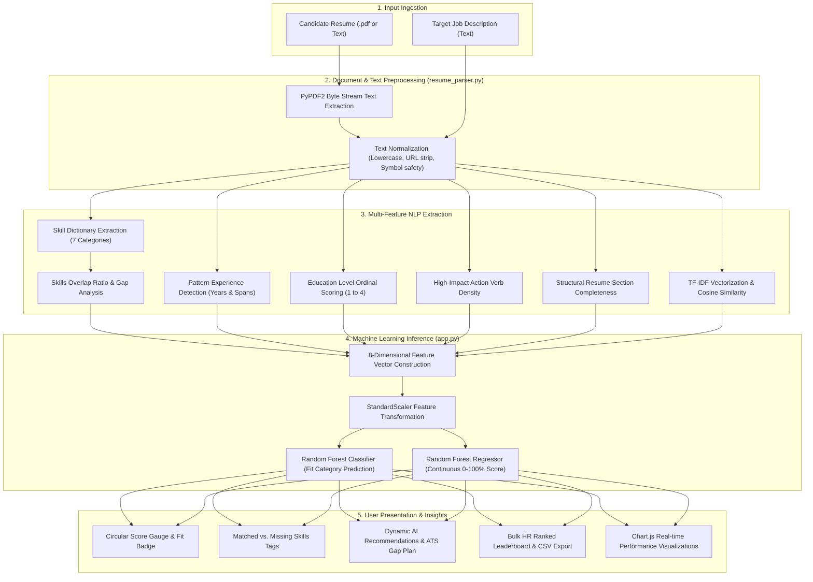

# ResumeMatch.AI — Automated Resume Relevance & Candidate-Job Matching Engine
## Comprehensive Architecture, Technology Stack & System Workflow Guide

---

## 📌 Executive Summary

**ResumeMatch.AI** is an end-to-end Machine Learning and Natural Language Processing (NLP) web application designed to automate resume evaluation, candidate screening, and candidate-to-job description matching. 

Instead of relying solely on simple keyword matching or pure text similarity, the system implements a **multi-dimensional feature extraction pipeline** combined with **Supervised Machine Learning models** (Random Forest Classifier & Regressor). It scores resumes on a continuous scale (0–100%), classifies them into discrete suitability tiers (*Highly Relevant*, *Moderate Fit*, *Low Relevance*), flags missing technical skills, evaluates experience and education alignment, and provides actionable recommendations to optimize resumes for Applicant Tracking Systems (ATS).

---

## 🛠️ 1. Complete Technology Stack ("All Things Used Here")

### A. Programming Language & Runtime
* **Python 3.13 / 3.x**: Core backend programming language executing data generation, feature engineering, ML training, and inference.

### B. Machine Learning & Scientific Computing
* **Scikit-Learn (`scikit-learn >= 1.3.0`)**:
  * `RandomForestClassifier`: Primary multi-class classification engine (100 estimators, max depth 8).
  * `RandomForestRegressor`: Continuous match score regressor (0–100%).
  * `GradientBoostingClassifier`: Benchmark ensemble tree model.
  * `LogisticRegression`: Linear baseline multi-class model.
  * `TfidfVectorizer`: N-gram TF-IDF text representation with stop-words removal (500 max features).
  * `cosine_similarity`: Vector angle similarity computation.
  * `StandardScaler`: Z-score normalization ($z = \frac{x - \mu}{\sigma}$) for multi-feature scaling.
  * Evaluation Metrics: `accuracy_score`, `precision_score`, `recall_score`, `f1_score`, `confusion_matrix`, `mean_absolute_error`, `r2_score`.
* **NumPy (`numpy >= 1.24.0`)**: Vectorized matrix calculations, random distributions, and bounding functions (`np.clip`).
* **Pandas (`pandas >= 2.0.0`)**: Dataframe operations, synthetic dataset generation, and CSV manipulation.
* **Joblib (`joblib >= 1.3.0`)**: High-performance serialization and loading of trained models, scalers, and vectorizers.

### C. Natural Language Processing & Document Parsing
* **PyPDF2 (`PyPDF2 >= 3.0.0`)**: In-memory byte extraction of plain text from multi-page PDF documents.
* **Regular Expressions (`re`)**:
  * Custom text normalization (removal of URLs, special characters while preserving symbols like `C++`, `C#`, `.NET`).
  * Regex word boundary matching (`\b<skill>\b`) against a multi-domain tech dictionary.
  * Pattern-based extraction of numerical experience years (`(\d{1,2})\s*\+?\s*years?`).
  * Chronological year span detection (`2018 - 2023`).
  * Education tier classification (PhD, Master's, Bachelor's, Associate).
  * High-impact action verb detection (`engineered`, `spearheaded`, `optimized`, etc.).
  * Structural section detection (Summary, Experience, Skills, Education).

### D. Web Backend & REST API Framework
* **Flask 3.x (`Flask >= 3.0.0`)**:
  * Lightweight WSGI web framework.
  * REST API endpoints handling JSON payloads and `multipart/form-data` file uploads.
  * Jinja2 server-side HTML template rendering.
  * Configured with 16MB file upload limit (`MAX_CONTENT_LENGTH = 16 * 1024 * 1024`).

### E. Frontend Technologies & UI Libraries
* **HTML5 & Jinja2 Templates**: Semantic layout with modular inheritance (`base.html`).
* **Modern CSS3**:
  * Custom Glassmorphism design system.
  * Dark theme palette with CSS Custom Properties / Variables (`--bg-primary`, `--accent-indigo`, etc.).
  * Responsive CSS Flexbox and CSS Grid layouts.
* **Vanilla JavaScript (ES6+)**:
  * Asynchronous `Fetch API` for non-blocking server communication.
  * Drag-and-drop file upload handling.
  * Client-side dynamic CSV generation and download using `Blob` and `URL.createObjectURL`.
  * Dynamic DOM manipulation for KPI cards, gauge animations, and leaderboards.
* **Chart.js (v4.x CDN)**:
  * Interactive canvas charts for algorithm comparison (Accuracy & Macro F1).
  * Horizontal bar chart for Feature Importances.
  * Model Confusion Matrix visualizer.
* **FontAwesome 6 (CDN)**: Comprehensive vector icon set for interface elements.
* **Google Fonts**: Modern typography featuring `Plus Jakarta Sans` and `Space Grotesk`.

---

## 🔄 2. System Workflow & Architecture ("What All Things Are Happening Here")



---

## 🧩 3. Detailed Component Breakdown

### Component 1: Text Parsing & NLP Feature Extraction (`resume_parser.py`)

This module extracts structured numerical signals and qualitative insights from unstructured resume and job description text.

1. **PDF Text Extraction (`extract_text_from_pdf`)**:
   Reads uploaded PDF bytes via `PyPDF2.PdfReader`, iterates through all document pages, extracts embedded text, and compiles a clean string.
2. **Text Normalization (`clean_text`)**:
   * Converts text to lowercase.
   * Strips out URLs (`http\S+`).
   * Cleans punctuation while preserving tech keywords like `C++`, `C#`, `.NET` using regex `[^\w\s\+\#\.\-]`.
3. **Skill Dictionary Matching (`extract_skills`)**:
   Maintains a categorized database of **120+ technical skills** across 7 domains:
   * *Programming Languages*: Python, Java, C++, JavaScript, TypeScript, Go, SQL, Bash...
   * *Machine Learning & AI*: TensorFlow, PyTorch, Scikit-Learn, NLP, Transformers, LLMs, Computer Vision...
   * *Web Technologies*: React, Next.js, Vue, Node.js, Express, Flask, Django, FastAPI, REST APIs...
   * *Cloud & DevOps*: AWS, Azure, GCP, Docker, Kubernetes, Terraform, CI/CD, Jenkins, Linux...
   * *Databases*: PostgreSQL, MySQL, MongoDB, Redis, Elasticsearch, Snowflake...
   * *Data Engineering*: Spark, Kafka, Airflow, ETL, Databricks...
   * *Management & Agile*: Scrum, Agile, Jira, Leadership, System Design...
   Uses regex boundary matching (`(?:\b|_)<skill>(?:\b|_)`) to prevent partial substring false positives (e.g., matching "go" inside "good").
4. **Experience Years Estimation (`extract_experience_years`)**:
   * Uses multi-pattern regex to detect direct mentions: `"5+ years of experience"`, `"3 yrs experience"`, `"4 years working"`.
   * Fallback heuristic: Detects 4-digit calendar years (`2018 - 2023`), calculates the span between minimum and maximum detected years.
5. **Education Tier Scoring (`extract_education_level`)**:
   Maps degrees to an ordinal scale:
   * Level 4: PhD / Doctorate
   * Level 3: Master's Degree (M.S., M.Tech, MBA)
   * Level 2: Bachelor's Degree (B.S., B.Tech, B.E.)
   * Level 1: Associate / Diploma / High School
6. **Action Verb Density (`extract_action_words`)**:
   Counts 24 high-impact resume action verbs (*engineered, developed, spearheaded, architected, optimized, deployed, automated*).
7. **Structural Section Completeness (`get_section_completeness`)**:
   Scans for standard resume sections: **Summary**, **Experience**, **Skills**, and **Education** (25% weight per detected section).

---

### Component 2: Machine Learning Training Pipeline (`model_trainer.py`)

This module generates a representative training dataset, constructs the feature space, trains multiple supervised models, evaluates performance, and serializes the artifacts.

1. **Role Profiles & Synthetic Dataset Generation**:
   * Defines 8 target industry role profiles (*Data Scientist, Senior Software Engineer, Frontend Developer, DevOps Engineer, Data Analyst, Project Manager, Full Stack Engineer, AI/ML Engineer*) with specific required skills, experience thresholds, and education expectations.
   * Generates **1,000 synthetic resume-JD pairs** across three realistic distributions:
     * High relevance (40%): 75–100% skill match, experience alignment, strong action verbs.
     * Medium relevance (40%): 40–70% skill match, slight experience gap.
     * Low relevance (20%): 0–35% skill match, unrelated noise skills.
2. **The 8-Dimensional Feature Vector**:
   For every resume-JD pair, the pipeline constructs this exact vector:
   $$\vec{X} = [\text{TF-IDF Cosine Sim}, \text{Overlap Ratio}, \text{Matched Count}, \text{Missing Count}, \Delta\text{Exp}, \Delta\text{Edu}, \text{Action Verbs}, \text{Section Score}]$$
3. **Data Splitting & Standardization**:
   * Stratified 80/20 train/test split (800 training samples, 200 test samples).
   * Feature scaling using `StandardScaler` to ensure distance and gradient-based models treat all dimensions uniformly.
4. **Models Trained & Serialized**:
   * `RandomForestClassifier` (100 trees, max depth 8) $\rightarrow$ Classification.
   * `RandomForestRegressor` (100 trees) $\rightarrow$ Continuous match score ($10.0\% - 99.0\%$).
   * `GradientBoostingClassifier` $\rightarrow$ Comparative ensemble.
   * `LogisticRegression` $\rightarrow$ Linear baseline.
   * Artifacts saved via `joblib` in the `models/` folder.

---

### Component 3: Flask Web Server & Inference Engine (`app.py`)

1. **Model In-Memory Loading**:
   Loads pre-trained `.joblib` models and `model_metrics.json` once when Flask boots up, ensuring sub-100ms inference times.
2. **Inference Function (`predict_resume_relevance`)**:
   * Extracts text and computes the 8-dimensional feature vector.
   * Scales features using the loaded `scaler.joblib`.
   * Predicts discrete suitability class and continuous score.
   * Generates **context-aware AI recommendations**:
     * Highlights top missing required skills.
     * Flags experience deficits and suggests emphasizing leadership or complexity.
     * Flags low action verb count and advises using strong action verbs.
     * Flags missing resume sections for ATS compliance.
3. **Web Routes**:
   * `GET /`: Single resume matcher interface.
   * `GET /bulk`: Bulk candidate screener and leaderboard.
   * `GET /optimizer`: ATS keyword gap optimizer.
   * `GET /analytics`: ML model performance dashboard.
4. **REST API Endpoints**:
   * `POST /api/match`: Accepts resume text/PDF + JD, returns full analysis.
   * `POST /api/bulk_match`: Accepts multiple PDFs or candidate array, returns ranked leaderboard.
   * `GET /api/model_info`: Returns model metrics, accuracy, and feature weights for Chart.js.
   * `GET /api/sample_data`: Supplies pre-loaded demo resumes and job descriptions for 1-click testing.

---

### Component 4: Interactive Frontend User Experience

1. **Single Matcher (`index.html` + `main.js`)**:
   * Tab switch between pasting text or uploading `.pdf` / `.txt` files.
   * 1-Click Demo presets for Data Scientist, Data Engineer, and Frontend Developer.
   * Dynamic CSS conic-gradient circular gauge showing match percentage.
   * Interactive pills for matched skills (emerald) and missing skills (amber).
2. **Bulk Screener & Leaderboard (`bulk.html`)**:
   * Drag-and-drop multiple resume PDFs or load a 5-candidate sample pool.
   * Auto-sorts applicants by ML match score.
   * Displays KPI cards (Total Applicants, High Matches, Average Score, Top Score).
   * **CSV Download Export**: Generates a `.csv` report of candidates, ranks, scores, and matched skills directly in the browser.
3. **ATS Keyword Optimizer (`optimizer.html`)**:
   * Side-by-side comparison of present keywords vs missing target skills.
   * Gauge for action verb density and section structure.
   * Step-by-step action plan to maximize recruiter ATS pass-rates.
4. **Interactive Analytics (`analytics.html` + `analytics.js`)**:
   * Chart.js bar chart comparing Random Forest, Gradient Boosting, and Logistic Regression.
   * Horizontal bar chart displaying relative feature importances.
   * $3 \times 3$ confusion matrix breakdown.

---

## 📊 4. Model Evaluation & Benchmark Results

### Algorithm Performance Comparison

| Algorithm | Model Type | Accuracy | Precision (Macro) | Recall (Macro) | F1-Score (Macro) |
| :--- | :--- | :---: | :---: | :---: | :---: |
| **Random Forest Classifier (Champion)** | Ensemble (Bagging) | **96.50%** | **0.9686** | **0.9669** | **0.9675** |
| **Logistic Regression (Baseline)** | Linear Model | **95.00%** | **0.9511** | **0.9552** | **0.9528** |
| **Gradient Boosting Classifier** | Ensemble (Boosting) | **93.50%** | **0.9377** | **0.9398** | **0.9384** |
| **Random Forest Regressor (Score)** | Ensemble Regression | **MAE: 2.09%** | **$R^2$: 0.9867** | — | — |

### Feature Importance Ranking (What Influences the Score Most?)

```
Skills Overlap Ratio       ████████████████████████████  29.54%
Missing Skills Count       ███████████████████  19.85%
Matched Skills Count       ██████████████████  19.17%
Action Verb Density        ███████████  11.33%
Experience Difference      ████████  8.63%
TF-IDF Text Similarity     ████████  8.12%
Education Difference       ██  2.47%
Section Completeness       █  0.90%
```

### Random Forest Confusion Matrix ($N=200$ test samples)

| True \ Predicted | Class 0 (Low) | Class 1 (Moderate) | Class 2 (High) | Total |
| :--- | :---: | :---: | :---: | :---: |
| **Class 0 (Low Fit)** | **51** | 1 | 0 | 52 |
| **Class 1 (Moderate Fit)**| 0 | **69** | 2 | 71 |
| **Class 2 (Strong Match)**| 0 | 4 | **73** | 77 |

* *Interpretation*: Only 7 out of 200 candidates were misclassified, with zero extreme errors (no Low fit candidate was ever misclassified as High fit).

---

## 🎓 5. Viva / Presentation Q&A Cheat Sheet

* **Q1: Why combine TF-IDF with custom NLP features instead of just using TF-IDF or BERT?**
  * *Answer:* TF-IDF only measures vocabulary similarity. It cannot discern whether a number represents years of experience or a graduation year, nor can it evaluate education hierarchy or distinct skill gaps. By combining TF-IDF with structured domain features (skills overlap, experience delta, education tier, action verbs), the Random Forest receives actionable signals tailored to hiring criteria.
* **Q2: Why use both a Classifier and a Regressor?**
  * *Answer:* The Regressor computes a continuous compatibility score (e.g., 84.5%) which is ideal for ranking candidates on an HR leaderboard. The Classifier categorizes candidates into discrete tiers (*High*, *Moderate*, *Low*) and provides class probability confidence percentages (e.g., 94.2% confident).
* **Q3: How does the system handle PDF resumes?**
  * *Answer:* The backend uses `PyPDF2` to read uploaded file streams into memory without writing temporary files to disk, extracts text across all pages, normalizes the text, and feeds it into the NLP feature extraction pipeline.
* **Q4: Why Random Forest over Gradient Boosting or Logistic Regression?**
  * *Answer:* Random Forest yielded the highest test accuracy (96.50%) and Macro F1 (0.9675), resisted overfitting due to ensemble bagging, and provided interpretable feature importance rankings.

---

## ⚡ 6. How to Run & Verify the Project

```powershell
# 1. Open PowerShell and navigate to the project folder
cd "C:\Users\Admin\.gemini\antigravity\brain\e4d5ad1b-2203-445e-87f9-69292bdb3de0\scratch\extracted\mini_pro"

# 2. Install dependencies
pip install -r requirements.txt

# 3. (Optional) Re-run model trainer to regenerate dataset and re-train models
python model_trainer.py

# 4. Start the Flask application
python app.py
```
Open **`http://127.0.0.1:5000`** in your browser.

---

## 💡 7. Recommended Tweak / Quick Fix
In [`mini_pro/templates/base.html`](file:///C:/Users/Admin/.gemini/antigravity/brain/e4d5ad1b-2203-445e-87f9-69292bdb3de0/scratch/extracted/mini_pro/templates/base.html#L41-L43), the navigation link to the Keyword Optimizer is commented out:
```html
<!-- <a href="/optimizer" class="nav-item active">
    <i class="fa-solid fa-wand-magic-sparkles"></i> Keyword Optimizer
</a> -->
```
Uncommenting this block in `base.html` immediately enables the ATS Keyword Optimizer tab in the navigation bar!
