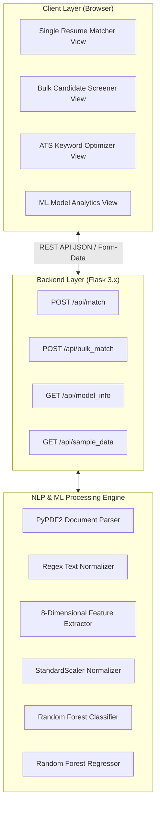

# Page 01: Executive Summary & Technology Stack
[Back to Documentation Index](file:///c:/Users/Admin/Desktop/ml%20mini%20project/docs/README.md) | [Next: NLP Pipeline & Feature Engineering ➡️](file:///c:/Users/Admin/Desktop/ml%20mini%20project/docs/02_NLP_PIPELINE_AND_FEATURE_ENGINEERING.md)

---

## 📌 1. Project Overview & Motivation

**ResumeMatch.AI** is an end-to-end Machine Learning and Natural Language Processing (NLP) web platform built to automate the screening, scoring, and ranking of candidate resumes against job descriptions.

### The Problem It Solves
Traditional hiring workflows face massive applicant volumes:
* Recruiter fatigue leads to inconsistent candidate evaluations.
* Basic Applicant Tracking Systems (ATS) rely solely on naive keyword exact-matching, penalizing qualified candidates who use synonyms.
* Standard cosine text similarity cannot evaluate numerical experience alignment, degree hierarchies, or structural completeness.

### The Solution Provided by This System
This system builds a **hybrid Natural Language Processing & Supervised Machine Learning engine**:
1. **Continuous Scoring**: Calculates a continuous 0–100% suitability match score using a Random Forest Regressor.
2. **Discrete Multi-Class Fit**: Categorizes applicants into 3 distinct classes (*High*, *Moderate*, *Low Fit*) with confidence percentages using a Random Forest Classifier.
3. **Multi-Dimensional NLP Signal Fusion**: Extracts 8 complementary signals including skill overlap, missing required skills, experience differentials, education levels, and action verb density.
4. **Bulk Screening & HR Leaderboard**: Allows recruiters to screen multiple resumes simultaneously with dynamic rank sorting and CSV export.
5. **ATS Optimization & Gap Analysis**: Pinpoints exact missing keywords, structural deficiencies, and provides actionable recommendations to improve resume match scores.

---

## 🛠️ 2. Comprehensive Technology Stack

### A. Core Runtime & Language
* **Python 3.13 / 3.x**: Primary language powering feature extraction, model training, and REST API services.

### B. Machine Learning, NLP & Data Science Libraries
* **Scikit-Learn (`scikit-learn >= 1.3.0`)**:
  * `RandomForestClassifier`: Primary multi-class classification model (100 estimators, max depth 8).
  * `RandomForestRegressor`: Continuous match score regressor (0–100%).
  * `GradientBoostingClassifier`: Benchmark ensemble tree boosting model.
  * `LogisticRegression`: Linear baseline multi-class classifier.
  * `TfidfVectorizer`: N-gram TF-IDF text representation with stop-words removal (500 max features).
  * `cosine_similarity`: Cosine angle similarity computation between vector representations.
  * `StandardScaler`: Z-score normalization ($z = \frac{x - \mu}{\sigma}$) for multi-feature scaling.
  * `train_test_split`: Stratified 80/20 train/test data splitting.
* **NumPy (`numpy >= 1.24.0`)**: Vectorized matrix calculations, random distributions, and bounding functions (`np.clip`).
* **Pandas (`pandas >= 2.0.0`)**: Dataframe operations, synthetic dataset generation, and CSV dataset manipulation.
* **Joblib (`joblib >= 1.3.0`)**: High-performance serialization and loading of trained models, scalers, and vectorizers.

### C. Document Parsing & Text Processing
* **PyPDF2 (`PyPDF2 >= 3.0.0`)**: In-memory byte extraction of plain text from multi-page PDF documents without writing temporary files to disk.
* **Regular Expressions (`re`)**:
  * Custom text normalization (removal of URLs, special characters while preserving symbols like `C++`, `C#`, `.NET`).
  * Regex word boundary matching (`\b<skill>\b`) against a multi-domain tech dictionary.
  * Pattern-based extraction of numerical experience years (`(\d{1,2})\s*\+?\s*years?`).
  * Chronological year span detection (`2018 - 2023`).
  * Education tier classification (PhD, Master's, Bachelor's, Associate).
  * High-impact action verb detection (`engineered`, `spearheaded`, `optimized`, etc.).
  * Structural section detection (Summary, Experience, Skills, Education).

### D. Web Backend & Server Architecture
* **Flask 3.x (`Flask >= 3.0.0`)**:
  * Lightweight WSGI web framework.
  * REST API endpoints handling JSON payloads and `multipart/form-data` file uploads.
  * Jinja2 server-side HTML template rendering.
  * Configured with 16MB file upload limit (`MAX_CONTENT_LENGTH = 16 * 1024 * 1024`).

### E. Frontend Technologies & UI Libraries
* **HTML5 & Jinja2 Templates**: Semantic layout with modular inheritance (`base.html`).
* **Modern CSS3**:
  * Custom Glassmorphism design system.
  * Dark theme palette with CSS Custom Properties / Variables (`--bg-primary`, `--accent-indigo`, etc.).
  * Responsive CSS Flexbox and CSS Grid layouts.
* **Vanilla JavaScript (ES6+)**:
  * Asynchronous `Fetch API` for non-blocking server communication.
  * Drag-and-drop file upload handling.
  * Client-side dynamic CSV generation and download using `Blob` and `URL.createObjectURL`.
  * Dynamic DOM manipulation for KPI cards, gauge animations, and leaderboards.
* **Chart.js (v4.x CDN)**:
  * Interactive canvas charts for algorithm comparison (Accuracy & Macro F1).
  * Horizontal bar chart for Feature Importances.
  * Model Confusion Matrix visualizer.
* **FontAwesome 6 (CDN)**: Comprehensive vector icon set for interface elements.
* **Google Fonts**: Modern typography featuring `Plus Jakarta Sans` and `Space Grotesk`.

---

## 🏛️ 3. High-Level System Architecture Diagram

---

[Back to Documentation Index](file:///c:/Users/Admin/Desktop/ml%20mini%20project/docs/README.md) | [Next: NLP Pipeline & Feature Engineering ➡️](file:///c:/Users/Admin/Desktop/ml%20mini%20project/docs/02_NLP_PIPELINE_AND_FEATURE_ENGINEERING.md)
