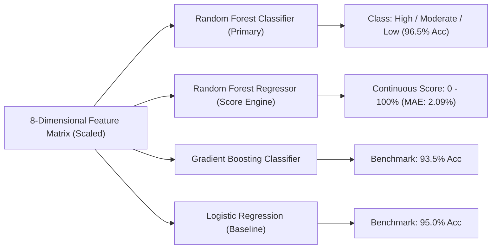

# Page 03: Machine Learning Models & Training Pipeline
[⬅️ Previous: NLP Pipeline & Feature Engineering](file:///c:/Users/Admin/Desktop/ml%20mini%20project/docs/02_NLP_PIPELINE_AND_FEATURE_ENGINEERING.md) | [Back to Index](file:///c:/Users/Admin/Desktop/ml%20mini%20project/docs/README.md) | [Next: Flask Backend & API Reference ➡️](file:///c:/Users/Admin/Desktop/ml%20mini%20project/docs/04_FLASK_BACKEND_AND_API_REFERENCE.md)

---

## 🎲 1. Synthetic Dataset Generation (`model_trainer.py`)

Because real resumes contain private Personally Identifiable Information (PII) and lack objective standardized ground-truth relevance labels, the project includes an automated synthetic data generator (`generate_dataset_and_features`).

### The 8 Role Profiles
The dataset models realistic industry roles with specific skill sets, experience thresholds, and education expectations:

1. **Data Scientist**: Skills in Python, ML, Deep Learning, SQL, Pandas, NumPy, Scikit-learn, TensorFlow, PyTorch, NLP. (Exp: 3+ yrs, Edu: Master's).
2. **Senior Software Engineer**: Skills in Java, Spring Boot, Microservices, Docker, Kubernetes, AWS, SQL, Git, REST API, CI/CD. (Exp: 5+ yrs, Edu: Bachelor's).
3. **Frontend Developer**: Skills in JavaScript, TypeScript, React, HTML, CSS, Tailwind, Redux, Next.js, Webpack. (Exp: 2+ yrs, Edu: Bachelor's).
4. **DevOps & Cloud Engineer**: Skills in AWS, Docker, Kubernetes, Terraform, Ansible, Jenkins, Linux, Bash, Python, CI/CD. (Exp: 4+ yrs, Edu: Bachelor's).
5. **Data Analyst**: Skills in SQL, Python, Tableau, Power BI, Excel, Pandas, Statistics, Problem Solving. (Exp: 2+ yrs, Edu: Bachelor's).
6. **Project / Product Manager**: Skills in Project Management, Agile, Scrum, Jira, Confluence, Leadership, Communication. (Exp: 5+ yrs, Edu: Master's).
7. **Full Stack Engineer**: Skills in Python, Django, React, JavaScript, PostgreSQL, Docker, AWS, Git, REST API. (Exp: 3+ yrs, Edu: Bachelor's).
8. **AI / ML Engineer**: Skills in Python, Deep Learning, PyTorch, Transformers, HuggingFace, LLM, Docker, FastAPI. (Exp: 4+ yrs, Edu: Master's).

### Distribution Sampling ($N = 1,000$ Samples)
Each role is sampled across 3 controlled suitability profiles:
* **High Relevance (40%)**: Selects $75\% - 100\%$ of target skills, allows small experience delta ($\pm 1$ to $+3$ years), includes $8 - 15$ action verbs, and complete resume sections.
* **Moderate Fit (40%)**: Selects $40\% - 70\%$ of target skills, slight experience deficit, includes $4 - 8$ action verbs, and mixed section completeness.
* **Low Relevance (20%)**: Selects $0\% - 35\%$ of target skills, introduces unrelated noise skills (`mongodb`, `dbt`, `ruby`, etc.), experience deficits, and low action verbs ($1 - 4$).

### Ground Truth Formulation
The continuous ground-truth match score is calculated using an objective domain formula with a small Gaussian noise perturbation:
$$\text{Score}_{\text{raw}} = (\text{Overlap Ratio} \times 60.0) + \left(\min\left(1.2, \max\left(0.3, \frac{\text{Exp}_{\text{cand}} + 1}{\text{Exp}_{\text{req}} + 1}\right)\right) \times 25.0\right) + \text{EduBonus} + \mathcal{N}(0, 2)$$

* $\text{EduBonus} = 10.0$ if $\text{Edu}_{\text{cand}} \ge \text{Edu}_{\text{req}}$, else $5.0$.
* The score is bounded between $15.0\%$ and $98.0\%$ using `np.clip`.

The target class is mapped into 3 discrete categories:
* **Class 2 (Highly Relevant / Strong Match)**: $\text{Match Score} \ge 75.0\%$
* **Class 1 (Moderate Fit / Potential Candidate)**: $50.0\% \le \text{Match Score} < 75.0\%$
* **Class 0 (Low Relevance / Unsuitable Fit)**: $\text{Match Score} < 50.0\%$

---

## ⚙️ 2. Vectorization & Feature Scaling

### TF-IDF Vectorization
```python
vectorizer = TfidfVectorizer(max_features=500, stop_words='english')
corpus = list(df['resume_text']) + list(df['jd_text'])
vectorizer.fit(corpus)
```
TF-IDF transforms the raw text corpus into sparse numerical vectors. Row-wise cosine similarities are then computed:
```python
res_tfidf = vectorizer.transform(df['resume_text'])
jd_tfidf = vectorizer.transform(df['jd_text'])
tfidf_sims = np.asarray((res_tfidf.multiply(jd_tfidf)).sum(axis=1)).flatten()
```

### Feature Scaling
Features possess vastly different physical scales:
* `skills_overlap_ratio` $\in [0.0, 1.0]$
* `matched_skills_count` $\in [0, 15]$
* `exp_diff` $\in [-5, +5]$
* `action_words_count` $\in [1, 20]$

To prevent large-magnitude features from dominating models like Logistic Regression and Gradient Boosting, all 8 features are transformed via `StandardScaler`:
$$z = \frac{x - \mu}{\sigma}$$

---

## 🤖 3. Supervised Model Training

The pipeline trains 4 distinct supervised models:



### 1. Random Forest Classifier (Primary Model)
```python
rf_clf = RandomForestClassifier(n_estimators=100, max_depth=8, random_state=42)
rf_clf.fit(X_train_scaled, y_train_cls)
```
* **Why it works best:** As an ensemble of 100 decision trees trained with bootstrap aggregation (bagging), it captures non-linear relationships and interactions (e.g., high skill overlap compensating for a small experience deficit). Setting `max_depth=8` prevents individual trees from overfitting to synthetic artifacts.

### 2. Random Forest Regressor (Continuous Match Engine)
```python
rf_reg = RandomForestRegressor(n_estimators=100, random_state=42)
rf_reg.fit(X_train_scaled, y_train_scr)
```
* Produces smooth, continuous compatibility scores from $10.0\%$ to $99.0\%$ for candidate ranking.

### 3. Gradient Boosting Classifier (Comparative Benchmark)
```python
gb_clf = GradientBoostingClassifier(n_estimators=100, learning_rate=0.1, random_state=42)
gb_clf.fit(X_train_scaled, y_train_cls)
```
* Builds sequential trees to minimize residual classification errors. Achieved **93.50%** accuracy.

### 4. Logistic Regression Classifier (Linear Baseline)
```python
lr_clf = LogisticRegression(random_state=42, max_iter=500)
lr_clf.fit(X_train_scaled, y_train_cls)
```
* Evaluates linear separability across the 8 scaled dimensions. Achieved **95.00%** accuracy.

---

## 💾 4. Model Artifact Serialization

All trained components and metadata are serialized into the `models/` folder using `joblib` and `json`:
* `models/resume_matcher_model.joblib`: Contains a Python dictionary holding both the fitted classifier and regressor, plus feature names:
  ```python
  model_payload = {
      'classifier': rf_clf,
      'regressor': rf_reg,
      'feature_names': feature_names
  }
  joblib.dump(model_payload, 'models/resume_matcher_model.joblib')
  ```
* `models/tfidf_vectorizer.joblib`: Fitted `TfidfVectorizer`.
* `models/scaler.joblib`: Fitted `StandardScaler`.
* `models/model_metrics.json`: Accuracy, Precision, Recall, Macro F1, Confusion Matrices, and Feature Importance percentages.

---

[⬅️ Previous: NLP Pipeline & Feature Engineering](file:///c:/Users/Admin/Desktop/ml%20mini%20project/docs/02_NLP_PIPELINE_AND_FEATURE_ENGINEERING.md) | [Back to Index](file:///c:/Users/Admin/Desktop/ml%20mini%20project/docs/README.md) | [Next: Flask Backend & API Reference ➡️](file:///c:/Users/Admin/Desktop/ml%20mini%20project/docs/04_FLASK_BACKEND_AND_API_REFERENCE.md)
